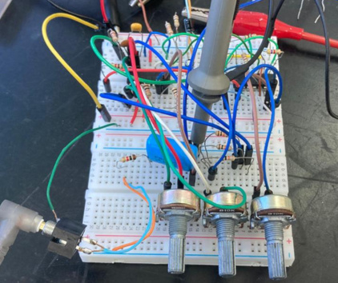
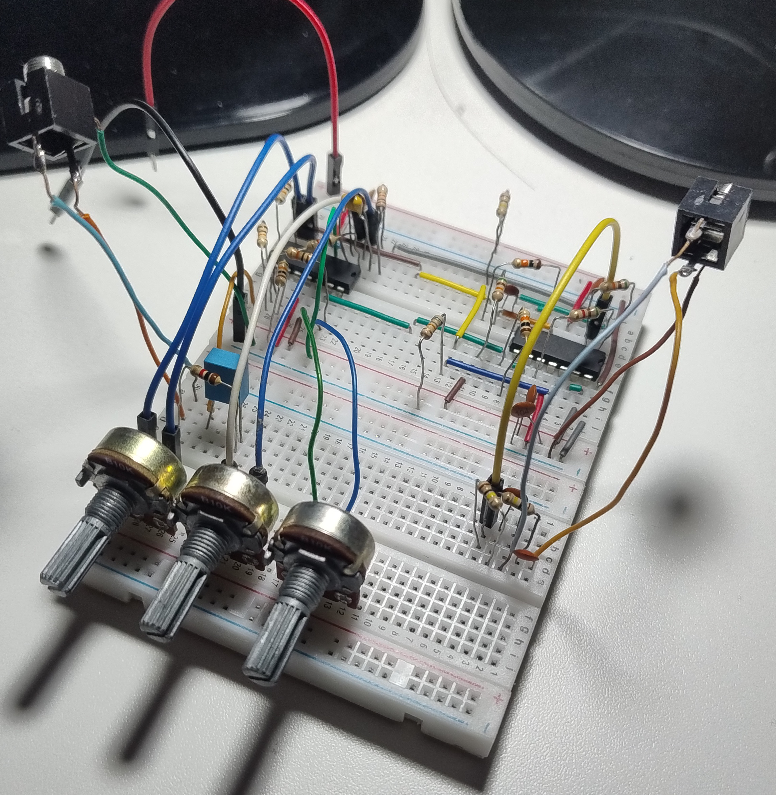
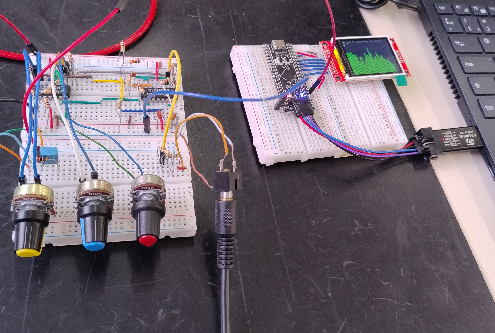
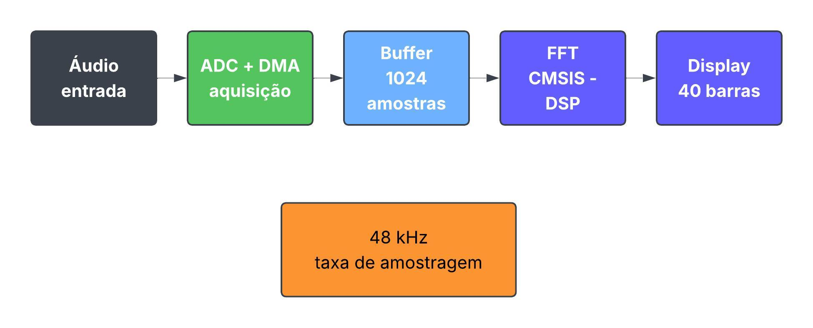
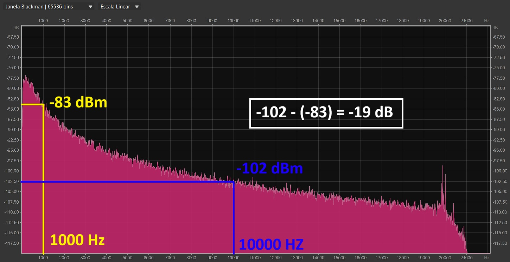
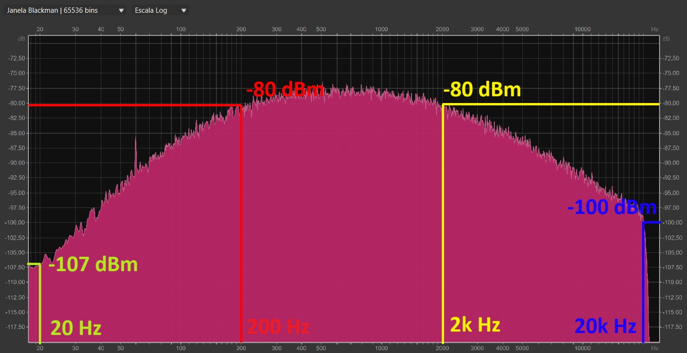
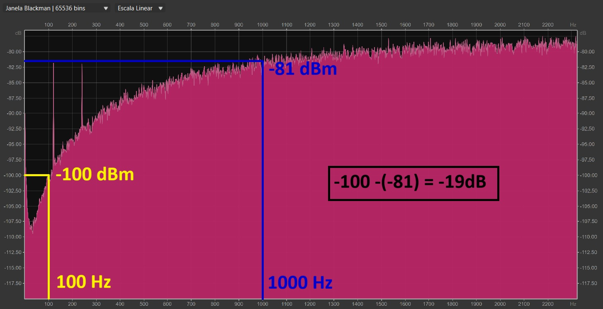
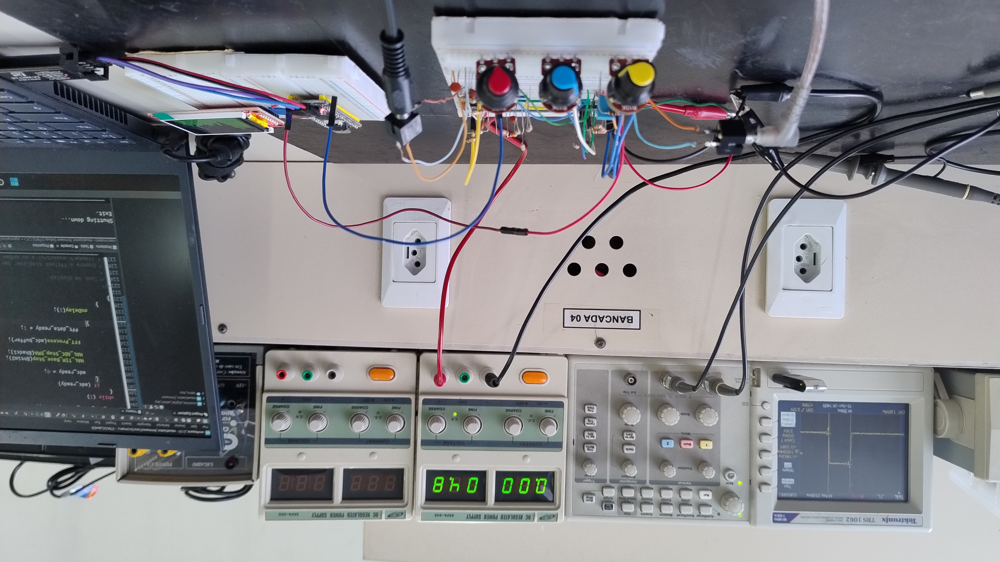
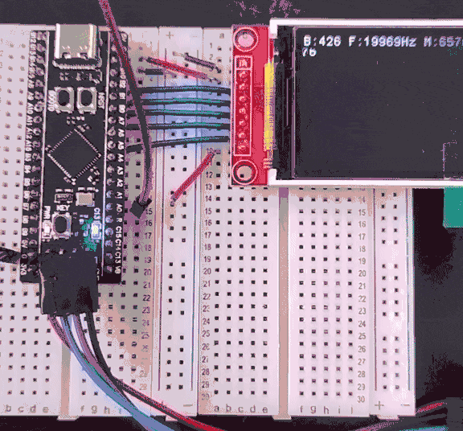

# Etapa 3

A Etapa 3 teve como objetivo implementar e validar o circuito analógico
do equalizador, integrá-lo ao sistema digital e verificar o
funcionamento conjunto. Os testes foram realizados em protoboard e
abrangeram as respostas dos filtros, a qualidade do áudio, a aquisição
pelo microcontrolador e a alimentação do sistema completo.

## Desenvolvimento

### Implementação do circuito analógico

A montagem inicial utilizou amplificadores operacionais TL074,
alimentados por uma fonte simétrica de ±12 V. Os filtros foram montados
e avaliados individualmente, começando pela banda de altas frequências
e, em seguida, incluindo as bandas médias e baixas. Posteriormente, os
três estágios foram integrados ao circuito somador e aos respectivos
potenciômetros, permitindo avaliar o comportamento individual e conjunto
das bandas. Como pode se observar na Figura 1.

*Figura 1 —  Montagem inicial usando o TL074.*

Também foi implementada a conversão da entrada estéreo para mono,
combinando os canais esquerdo e direito. A montagem inicial apresentava
muitos fios e ruído perceptível no áudio. Para melhorar sua
estabilidade, a protoboard foi reorganizada, reduzindo o comprimento das
conexões e aproximando os componentes. Foram adicionados capacitores de
desacoplamento à alimentação dos amplificadores operacionais, o que
reduziu significativamente o ruído observado. A remontagem pode ser 
vista na Figura 2.

*Figura 2 —  Montagem reorganizada do circuito analógico.*

Em seguida, o circuito foi adaptado para alimentação simples de 5 V.
Como o ADC do STM32 não admite tensões negativas, foi necessário
estabelecer uma referência de 2 V nos estágios analógicos pertinentes.
Essa tensão foi gerada por um divisor resistivo e estabilizada por um
amplificador operacional como buffer, substituindo as referências de GND
nos pontos necessários.

A adaptação foi inicialmente verificada com alimentação simétrica e
TL074. Depois, o TL074 foi substituído pelo LM324 para os testes com 5
V. Apesar de o circuito funcionar, foi percebida uma redução subjetiva
na definição do áudio e a presença de ruído. Após avaliar alternativas
compatíveis com alimentação simples e encapsulamento DIP, foi escolhido
o LMC660. A substituição foi feita na protoboard e proporcionou uma
melhora perceptível na qualidade sonora, sem problemas adicionais
durante os testes.

### Integração analógico-digital

A integração inicial manteve os módulos analógico e digital em
protoboards separadas, conectados por um GND comum e pelo sinal de saída
do equalizador à entrada ADC do STM32. O circuito analógico utilizava
uma fonte externa, enquanto o módulo digital era alimentado pela USB do
computador. O teste pode ser observado na Figura 3.

*Figura 3 —  Integração entre circuito analógico e módulo digital.*

Nos ensaios, um notebook reproduzia ruído branco pelo Ocenaudio,
enviando o sinal à entrada do equalizador. A saída era conectada à
entrada de áudio de outro notebook, também executando o Ocenaudio, para
visualizar o espectro processado. Simultaneamente, o STM32 adquiria o
sinal pelo ADC, processava as amostras por FFT e apresentava o resultado
no display ST7735.

Inicialmente, a escala utilizada pelo firmware não era adequada aos
níveis do sinal e impedia uma visualização satisfatória no display. Após
seu ajuste, foi possível comparar o espectro apresentado pelo STM32 com
o do Ocenaudio. Com os potenciômetros sem atenuação significativa, os
espectros de entrada e saída observados no Ocenaudio eram praticamente
coincidentes. Também foram testadas combinações que atenuavam
individualmente cada banda ou destacavam graves, médios e agudos. Além
do ruído branco, músicas foram utilizadas para avaliar auditivamente os
ajustes.

### Firmware

O firmware foi desenvolvido em C para o STM32F411, com os periféricos
configurados no STM32CubeMX [1] e a execução gerenciada pelo FreeRTOS
[2]. O código é dividido em módulos de processamento da FFT, que utiliza
a biblioteca CMSIS-DSP [3], e de controle do display ST7735, coordenados
pelo arquivo principal. A estrutura geral segue o diagrama de blocos
da [Etapa 2](../etapa_2/README.md).

O ADC adquire o sinal a 48 kHz, com transferência por DMA para um buffer
de 1024 amostras, o que resulta em uma resolução de 46,875 Hz por bin. A
conversão só é reiniciada após o término da FFT, evitando que novas
amostras sobrescrevam o buffer em uso. O fluxo
é mostrado na Figura 4. Após a remoção do nível DC e a
aplicação de uma janela de Hann, a FFT é calculada e os bins são
agrupados em 40 bandas de espaçamento logarítmico, usando a maior
magnitude de cada uma. Os valores são convertidos para decibéis em
relação a uma referência fixa, validada na bancada, com piso de −60 dB,
e exibidos com o display em modo paisagem (160x128 pixels).

*Figura 4 —  Fluxo da aquisição e processamento do firmware.*

## Testes

A análise no Ocenaudio permitiu verificar as respostas dos três filtros.
Nas bandas de graves, médias e agudas foi observada uma atenuação
aproximada de 20 dB por década, conforme esperado para os estágios
implementados. As capturas dos espectros foram editadas para destacar os
trechos analisados e apresentar a verificação matemática dessa
inclinação. Os resultados podem ser observados nas Figuras 5, 6 e 7. 

*Figura 5 —  Verificação da atenuação das altas frequências.*

*Figura 6 —  Verificação da atenuação das altas e baixas frequências.*

*Figura 7 —  Verificação da atenuação das baixas frequências.*

Por fim, foi testada a alimentação conjunta dos módulos. O pino de 5 V
do módulo digital foi conectado à fonte do circuito analógico,
permitindo desconectar o STM32 da USB. O sistema permaneceu ligado por
aproximadamente uma hora e meia, sem falhas ou aquecimento anormal. O
consumo foi estimado em menos de 10 mA para o circuito analógico isolado
e aproximadamente 75 mA para o conjunto com microcontrolador e display.
Esse teste em bancada pode ser notado na Figura 8.

*Figura 8 —  Testes dos módulos com uma única fonte de 5 V.*

Para validar o firmware e a integração analógico-digital, foi aplicado
na entrada do equalizador um sinal senoidal com frequência variando de
20 Hz a 20 kHz, gerado no Ocenaudio. No display, a barra de maior
amplitude se deslocou continuamente da esquerda para a direita,
percorrendo todo o espectro (Figura 9). O resultado confirmou a
aquisição pelo ADC, o cálculo da FFT e o mapeamento das frequências para
as barras, além do funcionamento conjunto dos módulos analógico e
digital.

*Figura 9 —  Varredura de frequência de 20 Hz a 20 kHz no display.*

## Referências

- [1] [STM32CubeMX](https://www.st.com/en/development-tools/stm32cubemx.html)
- [2] [FreeRTOS](https://www.freertos.org/)
- [3] [CMSIS-DSP](https://arm-software.github.io/CMSIS-DSP/latest/)
- [4] [ST7735](https://github.com/STMicroelectronics/stm32-st7735)
- [5] [Ocenaudio](https://www.ocenaudio.com/)
